<!--
  The pond is tended by .github/workflows/pond.yml every night:
  the koi (git-koi), the pond log (scripts/pond_log.py), and the static cards
  (scripts/build_assets.py). To change what a card says, edit CONTENT in
  scripts/build_assets.py and push; the workflow redraws it.
-->

  

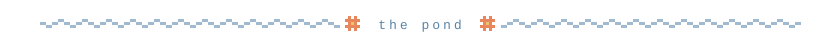

  

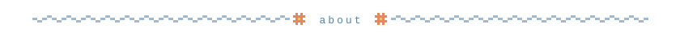

  
  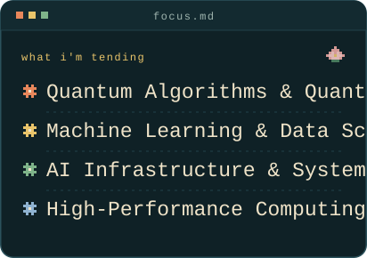

  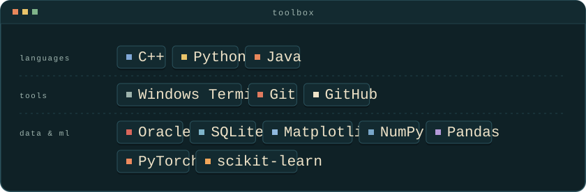

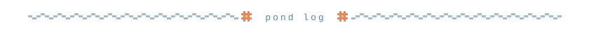

  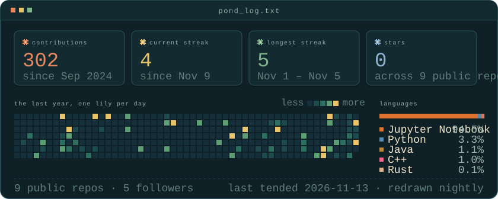

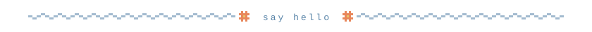

  <a href="mailto:sezeraptourachman@gmail.com">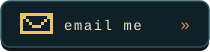</a>
  &nbsp;
  <a href="https://linkedin.com/in/sezerapt">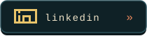</a>

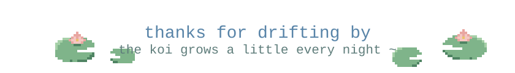

  
   
  koi drawn by <a href="https://github.com/yalongwastaken/git-koi">git-koi</a>

